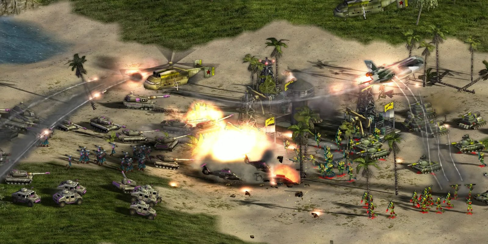
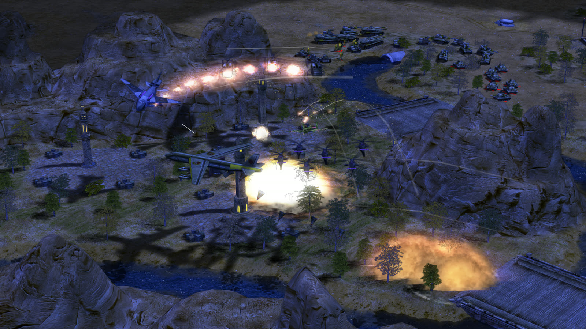
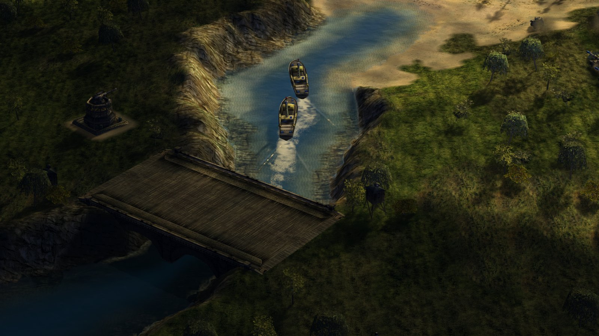
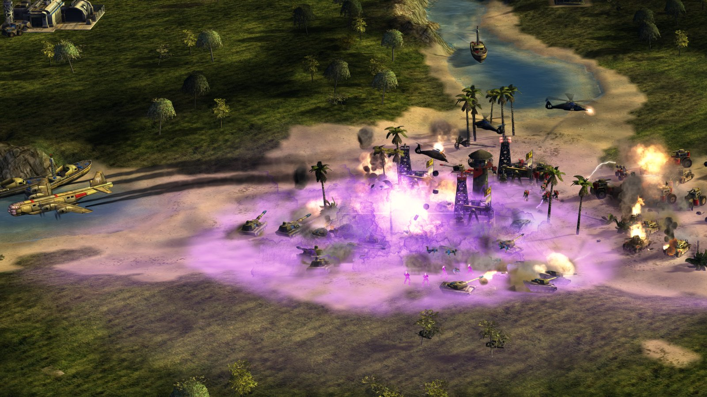
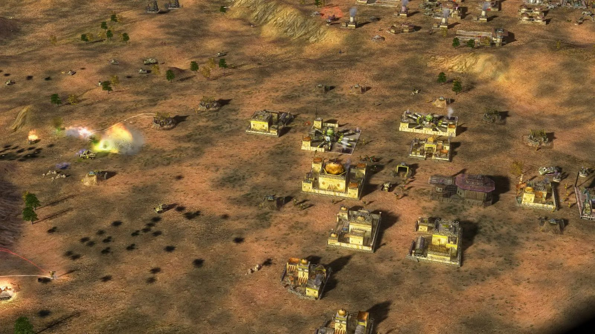
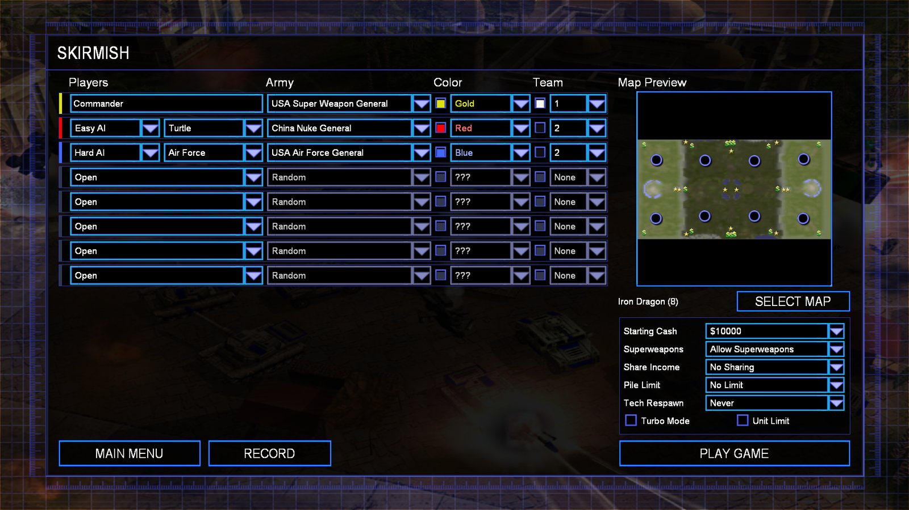
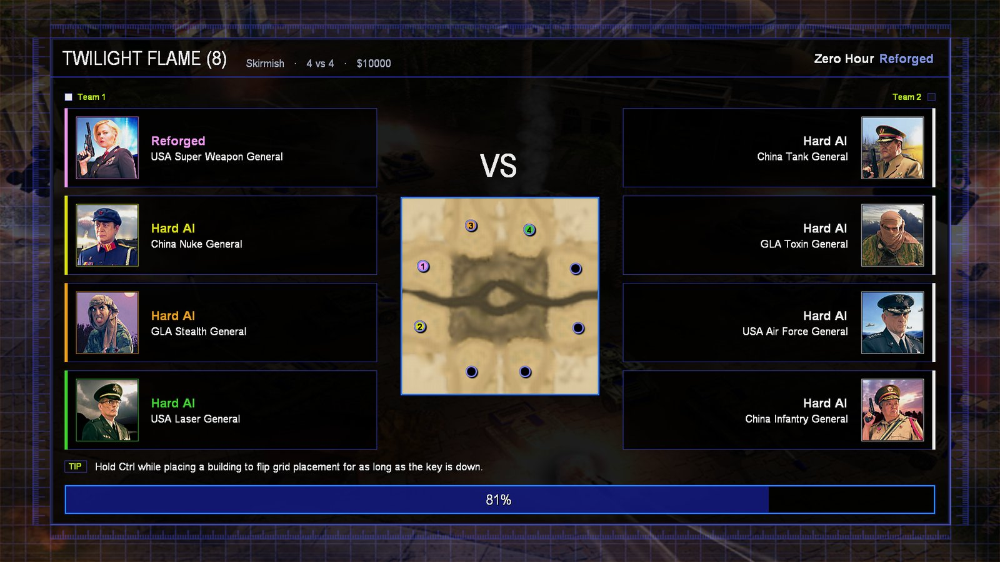
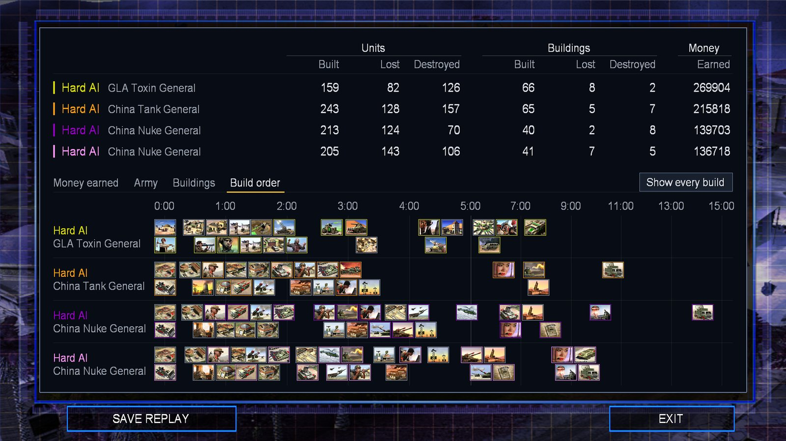

<picture><source media="(prefers-color-scheme: dark)" srcset=".github/media/banner-dark.png"></picture>

EA published the source of Command & Conquer: Generals and Zero Hour in February 2025. Zero Hour
Reforged is that source worked on as a game: around sixty bugs EA shipped in 2003 fixed, a computer
opponent that builds a base and plays without cheating, a Direct3D 11 renderer, a new interface and
mods that load side by side. Windows x64 players install it through a free launcher; macOS and Linux
build it from this repository.

Game v3.2.0, released 2026-10-20. Launcher v1.7.0, released the same day. `main` carries work that
is not in a release yet; it sits at the top of [CHANGELOG.md](CHANGELOG.md) and is marked `main` in
the tables below.

[](https://github.com/olcayseygan/CnCGeneralsZH-Reforged/releases/latest)
[](https://github.com/olcayseygan/CnCGeneralsZH-Reforged/commits/main)
[](LICENSE.md)

[zerohour.gg](https://zerohour.gg) · [Play it](#play-it) · [What is in it](#what-is-in-it) · [Every change](CHANGELOG.md) · [Build it](#build-it) · [How it is tested](#how-it-is-tested) · [Not there yet](#not-there-yet) · [Help out](#help-out) · [Discussions](https://github.com/olcayseygan/CnCGeneralsZH-Reforged/discussions)



<sub>A three-army fight over the oil derricks on a beach, a Helix and a MiG in the air, interface hidden.</sub>

## Where it runs

| Platform | Draws through | Where it stands |
|:--|:--|:--|
| Windows x64 | Direct3D 11, or Direct3D 9 with `-d3d9` | the build the launcher installs |
| Windows ARM64 | the same, with the port's own texture loader in place of `d3dx9_43.dll`, which has no ARM64 build | builds; the same code forced on x64 draws what x64 draws, and it has not yet run on an ARM64 machine |
| macOS, Apple silicon | Metal, through SDL3 | playable, as `Zero Hour Reforged.app` (ad-hoc signed, not notarised) |
| macOS, Intel | Metal, through SDL3 | builds and runs |
| Linux x86_64 and the Steam Deck | Vulkan, through SDL3 | playable; makes an AppImage, `.deb`, `.rpm`, Arch package and Flatpak, none of them carrying EA's files |
| Linux arm64 | Vulkan, through SDL3 | builds and passes ctest, no package yet |

None of it runs under Wine or Proton. A replay recorded on a Mac plays back on Linux and on Windows
to the same checksum, and a Mac and a Linux PC have played a LAN match without once disagreeing.

## Then and now

| | Before | Now | Since |
|:--|:--|:--|:--|
| Program | 32-bit, stalls and dies past 4 GB | 64-bit | 2.0.0 |
| Battle steps | 30 a second | 60 a second, every speed and reload converted | 3.0.0 |
| Late 4-player match, frames over 16.7 ms | 23% | 0.8%, the battle worked out on its own thread | 3.2.0 |
| Worst logic turn | `2,976 ms` | `243 ms` | 0.0.1-alpha |
| A 23-cell route | `55,000` cells searched in `256 ms` | `10,000` cells in `25 ms` | 0.0.1-alpha |
| Route searching over a match | `11.8 s` | `1.6 s` | 0.0.1-alpha |
| A screen of fire and smoke | 459 draw batches, `11.6 ms` a frame | 177 batches, `6.7 ms` | 1.0.3 |
| Smoke and fire sprites on screen | the rest silently dropped past about 16,000 | all 101,000 of a test drawn, `8.3 ms` a frame | 1.0.3 |
| Supply income, one pile, three sides | GLA 27 to 90 a second by stash distance, China 47 to 56, USA 55 | all three 49 to 60, near or far | 3.0.0 |
| A tank shell on a soldier | 6 damage, 30 hits to kill a Ranger | 60 damage, three hits | 3.2.0 |
| A Raptor's half circle at cruise | `1.7 s`, sliding sideways | `3.2 s`, banked | 3.2.0 |
| A kill's veterancy | all of it to the last shot | a quarter to the last shot, the rest shared by damage done in the last ten seconds | 2.4.0 |
| Ranks | three chevrons on every side | USA 28 grades, China 19, GLA 20 | `main` |
| Maps a network room lists | 100, and 300 in skirmish | 4,096 | `main` |
| First toxin cloud on a fresh install | a `3.5 s` freeze | no freeze, its shaders ship with the game | `main` |
| First superweapon strike on a fresh install | a `110` to `130 ms` hitch each | none | `main` |
| Base game textures | Zero Hour's downscaled copies | 481 originals at four times the resolution | 0.0.1-alpha |

## What is in it

Each row names the game version it arrived in. `main` means it is on this branch and in no release
yet. [CHANGELOG.md](CHANGELOG.md) has the measurements behind every line.

### Graphics

| What | Since |
|:--|:--|
| Direct3D 11 draws by default, with glow and edge smoothing over the battlefield only; `-d3d9` brings back the old renderer | 1.0.0 |
| Shadows soften and pale as the caster leaves the ground, so a helicopter's spreads as it climbs and a tank's stays hard | 2.0.0 |
| Classic Graphics puts the 2003 look back in one click | 2.0.0 |
| Fullscreen Fit picks stretch or bands when the resolution is not the monitor's shape | 2.6.0 |
| The whole options screen is in the game again, every page the launcher sets | 3.1.0 |
| The options screen restyled to match the other menus | 3.2.0 |
| Trees cast the shadow of their crowns, gaps between the fronds included, on Direct3D 11 on Windows and Linux | `main` |
| Linux draws the sun's shadows and the smoke shadows Windows already had | `main` |
| Modern water, under Options > Water Style: waves that catch the sun, foam at the shore and off boat hulls; Classic stays the default | `main` |
| Volumetric hazard clouds, under Options > Cloud Style: toxin, anthrax and nuclear fields as moving smoke at their real size and length; Classic stays the default | `main` |
| Fire burns: 182 kinds of flame start white-hot and cool through yellow, orange and red to soot | `main` |
| Warm Light and Haze, Team Color Glow and Water Foam, three Direct3D 11 looks, off until ticked; the haze costs 0.4 ms a frame | `main` |
| Explosion, lit smoke and cloud shaders ship with the game, and one nobody recorded is built beside the game instead of stopping the picture | `main` |



<sub>A night fight in a river valley: fire on the ground lights the trees from below while an A-10 and Comanches cross overhead.</sub>



<sub>Modern water, from Options > Water Style: two PT boats leave foam wakes up a channel. On `main`, not in 3.2.0.</sub>



<sub>An Anthrax Bomb cloud drawn volumetric, from Options > Cloud Style. On `main`, not in 3.2.0.</sub>

### The battle

| What | Since |
|:--|:--|
| Veterancy is shared by everyone who hurt the target in the last ten seconds; healing earns too | 2.4.0 |
| The three sides mine a supply pile at the same pace, near the drop-off or far from it | 3.0.0 |
| The battle runs 60 steps a second, double the 30 of 2003; every speed, delay and reload was converted, so a Crusader still fires every two seconds | 3.0.0 |
| `-logicthread 1` works the battle out on its own thread beside the drawing; off by default again after 3.3.0's crashes | 3.2.0 |
| Turbo mode replaces the speed dropdown: one lobby box, set by the host in a network game, two seconds of battle in every real one | 3.2.0 |
| Jets bank into turns, sweep wide at speed, take off down the runway, fly a landing circuit and taxi on their wheels | 3.2.0 |
| A jet shot down hits for 80 where it lands, 160 for a B-52 or a cargo plane, and leaves fire for about six seconds; its owner and allies are spared | 3.2.0 |
| A tank shell that hits a soldier does the 60 it does to a tank, where it did 6 | 3.2.0 |
| Missiles weave a few degrees in flight, the weave fading as they close in | 3.2.0 |
| A rank ladder for every army: 28 American grades from E-1 Private to General of the Army, 19 Chinese, 20 GLA, each with its insignia beside the health bar; the top is 120 kills of a unit like your own | `main` |
| A hacker left without orders for ten seconds walks into an Internet Center with a free seat or opens its laptop where it stands | `main` |

### The computer opponent

One wrong value kept EA's skirmish AI building only what its script marked urgent, plus a single
power plant. It builds a base now, scouts with one cheap unit and counts only what it has seen. Easy,
Medium and Hard differ in what the computer may decide. No level gets extra money, cheaper units,
faster building or longer sight. In 0.0.1-alpha, over 32 headless matches with the seats swapped
both ways, Hard beat Easy 15-0.

Since 3.2.0 each computer seat in the lobby also takes a personality, which says how it plays while
the difficulty says how well. Normal is the computer you know. The others are Attacker, Turtle,
Economist, Air Force, Rusher, Raider, Tech, Infantry, Armor, Sneaky, Opportunist, Supporter, Counter
and Random. No personality gets extra money, faster building or tougher units. Allies with one answer their team: an Air
Force strikes whoever hits your base, an Economist sends money to an ally who runs dry, and a beacon
or `help`, `attack` or `money` typed in chat asks them for it.



<sub>A Hard GLA computer player's base, interface hidden.</sub>



<sub>The skirmish lobby from 3.2.0: a Personality box beside each computer seat's level, the map and its rules always in view.</sub>

### Interface

| What | Since |
|:--|:--|
| A superweapon built, charged or fired anywhere flashes its name under the clock, yours white, an ally's blue, an enemy's red | 2.4.0 |
| German beside English and Turkish, chosen in Options or with `-language` | 2.5.0 |
| The command buttons stand in the middle of the bottom edge, the radar at the left and the selection at the right, each drawn at your screen's height | 3.0.0 |
| Every key rebinds on the launcher's Hotkeys page, with clashes marked before you play | 3.0.0 |
| Vote kick: `/kick` and a name starts a 30-second vote that passes only when every other living player answers `/yes` | 3.0.0 |
| The Hotkeys page is in the game too, as the last tab of the options screen | 3.1.0 |
| Health bars a third thinner, with lost health drawn as a dark stretch | 3.2.0 |
| Skirmish, LAN and online rooms laid out again: one row per seat, team colours, a square map preview, the rules always in view | 3.2.0 |
| A loading screen with a card per player and, in a network game, each player's own load bar | 3.2.0 |
| A score screen with a Summary page, money, army and building charts sampled every five seconds, and a build-order timeline | 3.2.0 |
| Every campaign mission open from the campaign menu | 3.2.0 |
| Each player's ping and frame rate on the Tab diplomacy screen in a network match, turning yellow for the one slowing it down | `main` |


<sub>The in-match interface in Turkish, 7:24 into a match against a Hard China computer player, the Ranger's build card open.</sub>



<sub>The 3.2.0 loading screen, eight players, at 81%.</sub>



<sub>The 3.2.0 score screen after four Hard computer players fought for about fifteen minutes.</sub>

### Replays

A replay is watched the way an observer watches a match (2.2.0). A strip along the bottom shows the
time reached and the whole length; click anywhere on it to jump there. Beside it are pause and five
speeds, from half to eight times the speed the match was played at. Every match is archived under its
own date-and-time name.

### Mods

| What | Since |
|:--|:--|
| `-mod <folder>` loads a mod's archives and its loose `Data` and `Art` files; give it once per mod, and the one named later wins | 3.0.0 |
| `-modfactions` puts two total conversions in one match, each army building from its own mod's units | 3.0.0 |
| `-modpatch <folder>` after a mod changes that mod and leaves the others alone | 3.0.0 |
| A `mod.json` names the mod and its version, and the names go into every replay | 3.0.0 |
| Reforged's balance, fixes, AI and menus load after the mod and win where both touch the same thing | 3.0.0 |
| Contra and The Power of the West start and play | 3.0.0 |
| Shockwave Chaos starts beside a second full mod | 3.2.0 |
| Five full mods side by side (Contra, ShockWave, Shockwave Chaos, The End of Days, Tiberian Dawn Redux) | `main` |
| Crashes fixed under Contra, The End of Days, Rise of the Reds, ShockWave, Shockwave Chaos and Reborn | `main` |

The launcher's Mods page installs mods from a catalog and marks each one a patch or a full mod.

## Play it

### Windows

1. Have Zero Hour installed from Steam or the EA app. No game data is included here; the launcher
   uses the files of that install.
2. Download the launcher from [zerohour.gg](https://zerohour.gg) and run it. The installer is not
   code signed, so Windows SmartScreen asks once before it starts.
3. The launcher finds your Zero Hour folder and lists every file it is about to write before it writes
   any. Each file it replaces is backed up first. Press Install, then Play.


<sub>Launcher v1.7.0, Home page.</sub>

The launcher downloads the build, checks every file against a signed list and keeps the game and
itself up to date. Its pages are Home, Mods, Maps, Replays, Hotkeys, Options, Health and Feedback, in
English, Turkish or German. Uninstall puts back the files your game had before. When the game
crashes, the launcher sends the report without asking you for anything.

### macOS and Linux

There is no launcher for these yet, so the game is built from this repository with one command (see
[Build it](#build-it)) and pointed at the Zero Hour you already have installed. The folder it wants is
the one holding `INIZH.big`, with the original Generals inside it as `ZH_Generals/` or beside it,
because Zero Hour mounts both. Saves and replays go to
`~/Library/Application Support/Command and Conquer Generals Zero Hour Data` on a Mac and
`~/.local/share/Command and Conquer Generals Zero Hour Data` on Linux.

<details>
<summary>Where it looks for Zero Hour</summary>

<br>

First match wins (`PosixInstallRoot.cpp`, `PosixChooseInstallRoot`):

1. `-root <folder>` on the command line
2. `InstallPath` in `Registry.ini` in the data folder above, while it still holds the game
3. The known places below, for the staged build (`build-linux/ZeroHourReforged/bin/generals`) and the packages.
   A bare `build-linux/generals` uses its own folder instead
4. A folder chooser, asked until the choice holds Zero Hour. The answer goes into `Registry.ini`

| Where | Linux | macOS |
|:--|:--|:--|
| `~/Games/<name>` | yes | yes |
| `<library>/steamapps/common/<name>` for every Steam library: `~/.local/share/Steam`, `~/.steam/steam`, `~/.steam/root`, Flatpak's `~/.var/app/com.valvesoftware.Steam/.local/share/Steam`, and each library their `libraryfolders.vdf` lists (an SD card's too) | yes | |
| `/Applications/<name>` | | yes |
| CrossOver and Whisky bottles: `drive_c/Program Files*/` (`EA Games`, `Origin Games`, `Steam/steamapps/common`, `Command & Conquer The First Decade`, or the folder itself) `/<name>` | | yes |

`<name>` is any of `Command & Conquer Generals Zero Hour`, `Command and Conquer Generals Zero Hour`,
`Command & Conquer Generals - Zero Hour`, `Command & Conquer(tm) Generals Zero Hour` or `Zero Hour`,
spelled exactly. A folder counts when it holds `INIZH.big` and the original Generals' `Textures.big`
is in it, in `ZH_Generals/`, in `../Command & Conquer Generals` or `../Command & Conquer(tm) Generals`
beside it, or in the folder `Generals\InstallPath` in `Registry.ini` names. File names inside these
folders match in any case. When only Generals is missing, the chooser asks for its folder too.

</details>

The upscaled art has no download there. Copy the `Reforged*.big` files into `ReforgedArt/` in that
folder by hand, or play at the original textures.

No install to point it at? `./extract-game.sh <iso|folder> [target]` lays the games out from a disc, an
`.iso` or a copy of a Windows install, without installing or Wine: Zero Hour into target, Generals into
`target/ZH_Generals`. The default target is `~/Games/Command & Conquer Generals Zero Hour`, after asking.
Run it once per disc. It needs `7z` or `bsdtar` for an `.iso`, and `unshield` for InstallShield discs.
Discs carry 1.00 and the engine is 1.04's, so files from a 1.04 install (Steam, the EA app) are safer.

### Command line

| Switch | What it does |
|:--|:--|
| `-d3d9` | draws through Direct3D 9 instead of Direct3D 11 |
| `-dx11post off` | the Direct3D 11 picture without its finishing passes |
| `-win`, `-fullscreen`, `-borderless` | the window mode for this run |
| `-xres <w>` `-yres <h>` | the resolution for this run |
| `-msaa [N]` | multisampling; bare is 4x, a number asks for N from 2 to 16 |
| `-language english\|turkish\|german` | the language for this run, over the one Options saved |
| `-mod <folder>` | loads a mod; repeat it for several, the later one wins |
| `-modpatch <folder>` | a patch for the mod given before it, or for Zero Hour's files when it comes first |
| `-modfactions` | each mod's armies join Zero Hour's instead of replacing them |
| `-replay <name>` | opens a replay from the replay folder, extension optional |
| `-loadsave <name>` | opens a save game the same way |
| `-quickstart` | skips the intro movie, the shell map and the menu animations |
| `-nologo`, `-novideo` | skip the EA logo, or every movie |
| `-noaudio` | starts with every sound off |
| `-logicthread 1` | works the battle out on its own thread beside the drawing; the default 0 works it out between frames |

<details>
<summary>For testing: unattended computer matches</summary>

<br>

| Switch | What it does |
|:--|:--|
| `-autoskirmish <players>` | starts a skirmish between computer players without the menus, 2 to 8 seats |
| `-aidiff easy\|medium\|hard` | the difficulty those players take |
| `-aipersona <slot> <name>` | gives one seat a personality by name, written into the replay like a lobby pick |
| `-observer` | watches the match instead of taking a seat |
| `-headless` | plays it with no window and no sound |

</details>

<details>
<summary>Settings the options screen does not show</summary>

<br>

`ShowAllyCursors = no` in `Options.ini`, in your Zero Hour Data folder, stops sending your mouse
position to allies and stops drawing theirs.

`Hotkeys.ini`, beside it, takes a block that brings back the command bar's keys as the game shipped
them: attack move, stop, guard, rally point, evacuate, sell and combat drop on their own labels'
letters, and every button that lost its letter to one of them keeping it.

```ini
FixedOrderKeys
  Enabled = No
End
```

</details>

## Build it

Each platform builds from a fresh clone with one command. It fetches what EA stripped and what GitHub
will not hold, configures, builds Release and leaves a game you can start. Put `test` after the
configuration to run the tests too, as in `./build-linux.sh Release test`.

| Platform | Command | Install first | Your Zero Hour files |
|:--|:--|:--|:--|
| Windows x64 | `build.bat` | Visual Studio 2022 with the Desktop C++ workload | the `*.big` next to `GeneralsMD/Run/generals.exe`, the base game's in `Run/ZH_Generals/` |
| Windows ARM64 | `build.bat` on an ARM64 machine, or `windows-ci.ps1 -Platform ARM64` on x64 (into `build-arm64`) | the same, with the ARM64 build tools | as x64 |
| macOS | `./build-macos.sh` | the Xcode command line tools, then `brew install cmake ninja` | left where they are installed; `build-mac/Zero Hour Reforged.app` finds them |
| Linux | `./build-linux.sh` | a C++ compiler, CMake, Ninja and the X11, Wayland, EGL and Vulkan headers SDL3 builds against; the script prints the apt, dnf or pacman line for anything missing | left where they are installed; `build-linux/ZeroHourReforged/bin/generals` finds them |

All four take the same arguments:

```console
build.bat                    :: Release
build.bat Debug              :: another configuration (Release, RelWithDebInfo, Debug)
build.bat Release test       :: and run ctest
build.bat Release generals   :: just the game
build.bat clean              :: throw the build tree away first
```

64-bit only. The 32-bit build and the last of the inline assembly went in September 2026, and
`-A Win32` is now a configure error.

<details>
<summary>Windows in detail</summary>

<br>

Double-click `build.bat`. On a clone that has never been built it finds cmake, fetches what EA
stripped, configures, builds, and copies the exe and the five FFmpeg DLLs into `GeneralsMD/Run/`,
which is where the game data is and the only place the game starts. About three minutes on a 2024
desktop.

Visual Studio 2022 with the Desktop C++ workload is the one prerequisite. It brings ATL, which
`PreRTS.h` needs; a Build Tools install needs the `Microsoft.VisualStudio.Component.VC.ATL` component
added. To run the game and its tests, the machine needs the DirectX End-User Runtime (June 2010) for
`d3dx9_43.dll`: Microsoft's full `directx_Jun2010_redist.exe`, because winget's `Microsoft.DirectX`
installs nothing.

What `build.bat` fetches into the places the repository leaves empty: zlib 1.1.4, LZH-Light 1.0, a
minimal DirectX 8 SDK, the GameSpy SDK, and the fork's own upscaled art from this repository's
`art-latest` release, checked against the sha256 in its `art.json`. Running it again costs a directory
check per library. STLport, the 3ds Max 4 SDK, NVASM and SafeDisc are not needed. Neither are the Miles
and Bink SDKs: sound and video are compiled into the exe over XAudio2 and FFmpeg, and the retail
`mss32.dll` and `BINKW32.DLL` are 32-bit images a 64-bit process cannot load anyway.

A machine that needs another cmake, generator or build folder puts its own `set` lines in
`build.local.bat` beside `build.bat`. It is git-ignored and read right after the defaults.

`windows-ci.ps1` is the whole Windows check in one command: build, ctest, the GPU tests in the desktop
session, and the replay CRCs.

The steps underneath, for when one of them is what you want:

```console
cmake -S GeneralsMD/Code -B build64 -G "Visual Studio 17 2022" -A x64
cmake --build build64 --config Release
ctest --test-dir build64 -C Release --output-on-failure
```

</details>

<details>
<summary>macOS and Linux in detail</summary>

<br>

`build-macos.sh` and `build-linux.sh` both run `GeneralsMD/Code/Tools/build-posix.sh`, which checks
the toolchain and names what to install, runs `vendor.sh`, configures with Ninja, builds, runs ctest
when asked and stages the game. A machine-specific override goes in `build.local.sh`, git-ignored.

On Ubuntu 24.04 the Linux packages are:

```sh
sudo apt-get install cmake ninja-build g++ git curl unzip xz-utils make pkg-config python3 libx11-dev \
  libxext-dev libxcursor-dev libxi-dev libxfixes-dev libxrandr-dev libxss-dev libxtst-dev libwayland-dev \
  libxkbcommon-dev wayland-protocols libegl-dev libdrm-dev libgbm-dev libvulkan-dev libfontconfig-dev lld unifdef
```

`GeneralsMD/Code/Tools/linux-portable.sh` builds inside Valve's Steam Runtime 3 "sniper" SDK and makes
one folder that runs on SteamOS and any desktop Linux of the last five years with nothing installed.
`GeneralsMD/Code/Tools/linux-packages.sh` wraps that folder as an AppImage, a `.deb`, an `.rpm`, an
Arch `.pkg.tar.zst` and a single-file `.flatpak`, each built in docker and checked for glibc 2.31 at
most. `add-to-menu.sh`, in the folder `./build-linux.sh` makes, puts the game in the desktop's app
menu with Generals' icon.

The game finds its install from `-root <dir>`, then `Registry.ini` in the user data folder, then the
usual places, then a folder chooser on the first launch. The install itself is never written to.
[PORTING.md](PORTING.md) has every build option and the known issues.

</details>

## How it is tested

There is no debugger on the machine this is built on, so the game tests itself. Code changes are
made with AI assistance, one person directs them, and replays and measurements test them.

- `ctest` runs 63 tests on a Windows build: the engine's and the libraries' own, plus the port's
  device, shader generators, file systems, input, audio, LAN and packaging.
- Headless, a whole skirmish between computer players plays out with no window and no sound, the
  same way on every run.
- A logic change is argued with replay CRCs. The 32-bit build and the 64-bit one played the same 3000
  frames of computer against computer to the same checksum before 32-bit was retired.
- An AI change is argued with headless matches on the same seeds, win rate and match length before
  and after.
- A graphics change is argued in pixels: the same frame of the same match from two builds, and the
  pixels between them counted.
- The SDL3 renderer is judged against FFReference, Direct3D 9's fixed-function pipeline computed in
  double precision from Microsoft's documentation and written independently of the device.
- Two copies over one real connection caught every multiplayer replay falsely reporting a desync
  since 2003.
- Every fix was proved by putting the bug back and watching its test fail.

What did not work stays written down. The first group movement rework and tree shadows cast from
stencil volumes were both built and measured, then taken back out, and CHANGELOG says why.

## Under the hood

`Main/WinMain.cpp` builds a `Win32GameEngine` (`Main/PosixMain.cpp` its SDL3 twin) and calls
`GameMain`. That class is the whole device binding: a dozen factories pick the concrete class behind
every abstract interface the engine names, and nothing under `GameEngine/` names a device type.

The logic and client split is the determinism boundary. `GameLogic` owns every `Object` and everything
that has to checksum identically on every machine in a network game; `GameClient` owns drawables and
input. Input never reaches logic directly. It becomes a message on a stream, and whatever survives the
translators lands on the command list for the next logic frame. Since 3.2.0, outside network games,
that frame is worked out on a thread of its own while the client draws the last one.
Objects are composed from modules declared in INI, so a new behaviour is a module class and an INI
block rather than an edit to `Object`.

| Path | What lives there |
|:--|:--|
| `GeneralsMD/Code/GameEngine/` | the game itself: logic, client, network, INI parsing |
| `GeneralsMD/Code/GameEngineDevice/` | the devices: W3D and Direct3D 11, SDL3 and POSIX, Win32, audio, video |
| `GeneralsMD/Code/Libraries/Source/WWVegas/` | Westwood's own libraries, older than the game and unaware of it |
| `GeneralsMD/Code/Data/` | the fork's INI, strings, interface pages and the Turkish and German text |
| `GeneralsMD/Code/Tests/` | the test harnesses, FFReference among them |
| `GeneralsMD/Code/Tools/` | the vendor scripts, packaging and the build fingerprint |
| `GeneralsMD/Run/` | where the exe lands, where your `*.big` go, and the only place the game starts |
| `Generals/` | the base game's tree as EA released it; nothing here builds it |
| `Tools/` | side tools in Python, PathLab for movement ideas and the balance harness among them |

A network join no longer compares the exe's bytes. It hashes a CRC-32 over the sources listed in
`GeneralsMD/Code/BuildFingerprint.manifest`, so two builds of the same source agree whatever compiled
them, and any source change separates them.

## Not there yet

- Internet play. LAN works between separate PCs; matches over the internet wait on a lobby server of
  Reforged's own, which is still on paper. A network game needs every player on the same version.
- A Direct3D 11 frame still costs a little more than a Direct3D 9 one, 7.6 ms against 6.3 ms on a
  screen full of Inferno Cannon fire. `-d3d9` is the way back.
- Modern water stops the first frame on a fresh install for about ten seconds while its two shaders
  compile. Volumetric clouds stay off by default until their cost in a big battle is measured.
- No gamepad, and no Direct3D 12.
- The Windows ARM64 build has not run on an ARM64 machine, and the macOS and Linux packages carry no
  upscaled art. A match between Windows and a Mac has not been played.
- Replays and mid-match saves from before 3.0.0's 60-step battle do not load. Replays recorded before
  the rank ladder and the other `main` changes to the battle play out differently.
- SafeDisc stays stubbed.

## Help out

The one machine this is built on cannot test a LAN match between two real PCs. Play one, Windows
against Windows or Windows against a Mac, and report it as an
[issue](https://github.com/olcayseygan/CnCGeneralsZH-Reforged/issues), a clean match as well as a
broken one.

Pull requests are welcome. [CONTRIBUTING.md](CONTRIBUTING.md) has the commit format and the check
every pull request runs, and [Discussions](https://github.com/olcayseygan/CnCGeneralsZH-Reforged/discussions)
is open for anything that is not an issue yet.

## Credits

Electronic Arts released the source in 2025. İlyas Akın (ilyasakin) wrote the macOS, Linux and Windows
ARM64 port, and Andreas Berger found the macOS and Linux build breaks that followed 3.0.0.
Fixes taken from [TheSuperHackers/GeneralsGameCode](https://github.com/TheSuperHackers/GeneralsGameCode),
the community's CMake port of the same source, are credited where they landed, in the code and in the
commits. Third-party libraries are fetched at pinned versions and keep their own licences;
[NOTICE.md](NOTICE.md) lists who wrote what and under which licence.

<details>
<summary>EA's original README</summary>

<br>

This repository includes source code for Command & Conquer Generals, and its expansion pack Zero Hour. This release provides support to the Steam Workshop for both games ([C&C Generals](https://steamcommunity.com/workshop/browse/?appid=2229870) and [C&C Generals - Zero Hour](https://steamcommunity.com/workshop/browse/?appid=2732960)).

### Dependencies

If you wish to rebuild the source code and tools successfully you will need to find or write new replacements (or remove the code using them entirely) for the following libraries;

- DirectX SDK (Version 9.0 or higher) (expected path `\Code\Libraries\DirectX\`)
- STLport (4.5.3) - (expected path `\Code\Libraries\STLport-4.5.3`)
- 3DSMax 4 SDK - (expected path `\Code\Libraries\Max4SDK\`)
- NVASM - (expected path `\Code\Tools\NVASM\`)
- BYTEmark - (expected path `\Code\Libraries\Source\Benchmark`)
- RAD Miles Sound System SDK - (expected path `\Code\Libraries\Source\WWVegas\Miles6\`)
- RAD Bink SDK - (expected path `\Code\GameEngineDevice\Include\VideoDevice\Bink`)
- SafeDisk API - (expected path `\Code\GameEngine\Include\Common\SafeDisk` and `\Code\Tools\Launcher\SafeDisk\`)
- Miles Sound System "Asimp3" - (expected path `\Code\Libraries\WPAudio\Asimp3`)
- GameSpy SDK - (expected path `\Code\Libraries\Source\GameSpy\`)
- ZLib (1.1.4) - (expected path `\Code\Libraries\Source\Compression\ZLib\`)
- LZH-Light (1.0) - (expected path `\Code\Libraries\Source\Compression\LZHCompress\CompLibSource` and `CompLibHeader`)

### Compiling (Win32 Only)

To use the compiled binaries, you must own the game. The C&C Ultimate Collection is available for purchase on [EA App](https://www.ea.com/en-gb/games/command-and-conquer/command-and-conquer-the-ultimate-collection/buy/pc) or [Steam](https://store.steampowered.com/bundle/39394/Command__Conquer_The_Ultimate_Collection/).

The quickest way to build all configurations in the project is to open `rts.dsw` in Microsoft Visual Studio C++ 6.0 (SP6 recommended for binary matching to Generals patch 1.08 and Zero Hour patch 1.04) and select Build -> Batch Build, then hit the “Rebuild All” button.

If you wish to compile the code under a modern version of Microsoft Visual Studio, you can convert the legacy project file to a modern MSVC solution by opening `rts.dsw` in Microsoft Visual Studio .NET 2003, and then opening the newly created project and solution file in MSVC 2015 or newer.

NOTE: As modern versions of MSVC enforce newer revisions of the C++ standard, you will need to make extensive changes to the codebase before it successfully compiles, even more so if you plan on compiling for the Win64 platform.

When the workspace has finished building, the compiled binaries will be copied to the folder called `/Run/` found in the root of each games directory.

### Known Issues

Windows has a policy where executables that contain words “version”, “update” or “install” in their filename will require UAC Elevation to run. This will affect “versionUpdate” and “buildVersionUpdate” projects from running as post-build events. Renaming the output binary name for these projects to not include these words should resolve the issue for you.

### STLport

STLport will require changes to successfully compile this source code. The file [stlport.diff](stlport.diff) has been provided for you so you can review and apply these changes. Please make sure you are using STLport 4.5.3 before attempting to apply the patch.

### Contributing

This repository will not be accepting contributions (pull requests, issues, etc). If you wish to create changes to the source code and encourage collaboration, please create a fork of the repository under your GitHub user/organization space.

### Support

This repository is for preservation purposes only and is archived without support.

</details>

<sub>GPL v3 with additional terms, see [LICENSE.md](LICENSE.md). Preservation release © Electronic Arts. Not affiliated with or endorsed by Electronic Arts.</sub>
